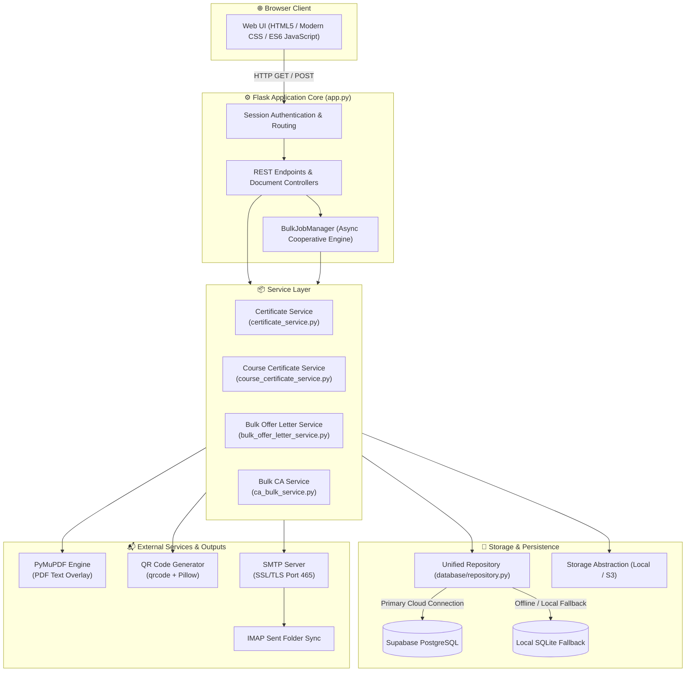
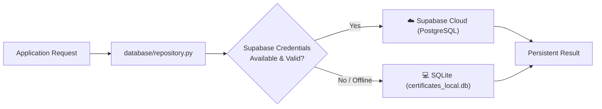
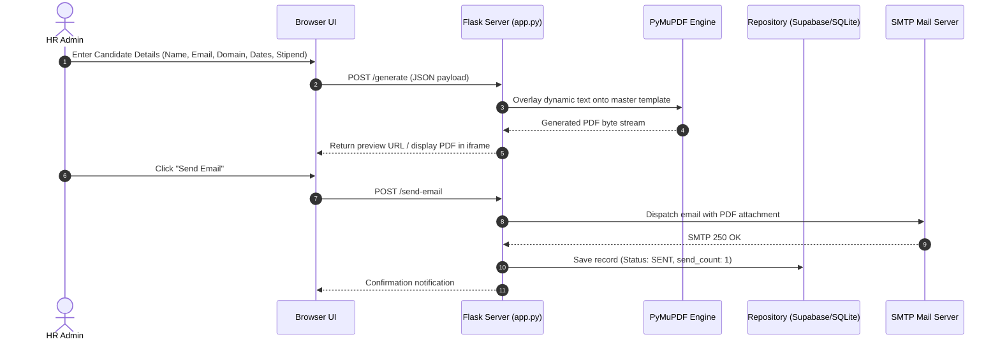
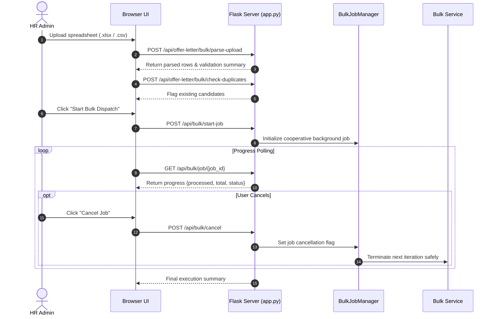
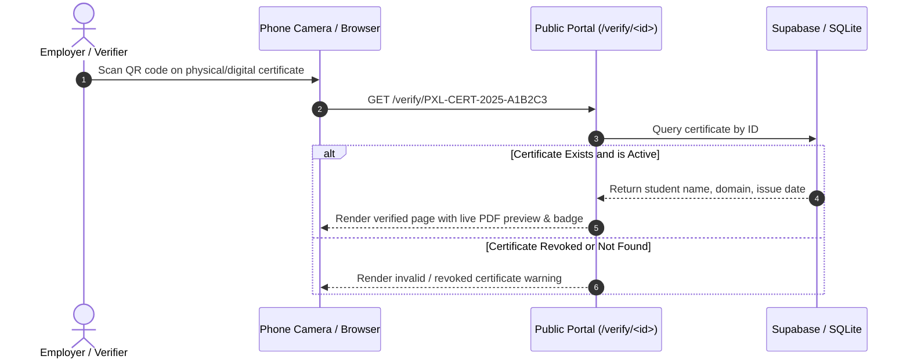

# Persevex Offer Letter & Certificate Generator

<p align="center">
  
</p>

<p align="center">
  <strong>A production-grade Flask application for generating, delivering, and verifying internship offer letters, campus ambassador appointments, and completion certificates — with dynamic PDF overlay, scannable QR verification, spreadsheet bulk processing, and email delivery automation.</strong>
</p>

<p align="center">
  
  
  
  
  
</p>

---

## Table of Contents

- [Project Overview](#project-overview)
- [Key Features](#key-features)
- [Screenshots & Visual Assets](#screenshots--visual-assets)
- [Technology Stack](#technology-stack)
- [System Architecture](#system-architecture)
- [Core Application Workflows](#core-application-workflows)
- [Project Directory Structure](#project-directory-structure)
- [Installation & Local Setup](#installation--local-setup)
- [Environment Configuration](#environment-configuration)
- [Usage Guide](#usage-guide)
- [Automated Testing](#automated-testing)
- [Deployment Guide](#deployment-guide)
- [Security & Data Protection](#security--data-protection)
- [Troubleshooting & FAQ](#troubleshooting--faq)
- [Contributing](#contributing)
- [License](#license)

---

## Project Overview

**Persevex Offer Letter & Certificate Generator** is an enterprise document automation and verification platform designed for [Persevex](https://persevex.com), an MSME-registered and Startup India-recognized organization.

Managing large-scale intern cohorts and campus ambassador programs manually creates severe bottlenecks: generating individual PDFs, emailing each recipient, preventing accidental duplicates, and verifying credentials after completion. 

This platform provides an end-to-end automated solution:

1. **Precision PDF Engine**: Overlays dynamic recipient data, stipend amounts, and variable date ranges onto official Persevex templates using PyMuPDF.
2. **Interactive Real-Time Preview**: Displays dynamic document previews directly in the browser before sending or downloading.
3. **Automated Secure Delivery**: Sends emails through authenticated SMTP with attachment handling and IMAP sent-folder synchronization.
4. **Resilient Data Persistence**: Uses Supabase (PostgreSQL) for cloud environments and seamlessly falls back to local SQLite for offline or restricted development.
5. **Tamper-Evident QR Verification**: Encodes unique certificate identifiers (`PXL-CERT-YYYY-XXXXXX`) into QR codes pointing to a publicly accessible verification portal.
6. **Cooperative Bulk Engine**: Ingests Excel and CSV spreadsheets, performs pre-flight validation and duplicate checks, tracks job progress asynchronously, and supports graceful mid-flight cancellation.

---

## Key Features

### 1. Document Generation Workflows

| Document Workflow | Master Template File | Generation Modes | Key Attributes |
|---|---|---|---|
| **Internship Offer Letter (With Hours)** | `pdf_templates/with_hours.pdf` | Single & Bulk | Predefined domains or custom domain, 2–6 month duration, stipend tiers, automatic weekly hours breakdown |
| **Internship Offer Letter (Without Hours)** | `pdf_templates/without_hours.pdf` | Single & Bulk | Standard appointment letter without weekly hours schedule |
| **Campus Ambassador Offer Letter** | `pdf_templates/campus_ambassador_template.pdf` | Single & Bulk | College name, ambassador role, custom tenure dates |
| **Internship Completion Certificate** | `pdf_templates/certificate_template.pdf` | Single & Bulk | Unique Certificate ID, QR verification code, domain, issue date |
| **Course Completion Certificate** | `pdf_templates/Course Completion Certificate.pdf` | Single & Bulk | Course name, student name, verified completion dates, QR link |
| **Campus Ambassador Certificate** | `pdf_templates/campus_ambassador_certificate.pdf` | Single & Bulk | Ambassador tenure, recognition badge, QR verification code |

#### Flexible Stipend Configuration
- **None**: For unpaid or academic internships
- **Preset Tiers**: ₹10,000 / month, ₹12,000 / month, ₹15,000 / month, ₹18,000 / month
- **Custom Stipend**: Freeform numeric amount with currency formatting

### 2. High-Performance Bulk Processing
- **Multi-Format Ingestion**: Accepts `.xlsx`, `.xls`, and `.csv` files with intelligent, case-insensitive header mapping.
- **Pre-Flight Validation**: Isolates invalid rows (e.g. malformed email addresses, missing dates) before job execution.
- **Duplicate Detection**: Identifies whether a candidate already received a document for the same domain or tenure.
- **Targeted Sending**:
  - `Send New Mails Only`: Dispatches only to candidates without prior successful delivery.
  - `Send All Mails`: Explicitly re-dispatches to all valid candidates in the batch.
- **Job Control**: Background job manager (`BulkJobManager`) with real-time status polling, completed/failed item counts, and non-blocking job cancellation.

### 3. Public Verification Portal
- Scannable QR code embedded on every certificate.
- Accessible via `/verify/<certificate_id>` (e.g., `/verify/PXL-CERT-2025-A1B2C3`).
- Renders:
  - Validated recipient details, course/domain, and issue date.
  - Live in-browser PDF preview.
  - High-resolution thumbnail image (`/verify/<id>/thumbnail`).
  - Direct verified PDF download (`/verify/<id>/download`).
  - Administrative revocation support via `/api/certificate/revoke/<id>`.

### 4. Unified History & Audit Dashboard
- Located at `/history`, providing unified visibility across all issued documents.
- Multi-criteria filtering by document type, search by student name, email, or certificate ID.
- Detailed audit attributes: `email_status`, `send_count`, `sent_at`, `created_at`, error logs.
- Single and bulk record deletion with safety confirmation.
- Export audit tables to formatted Excel (`.xlsx`) or comma-separated values (`.csv`).

### 5. Onboarding Email Automation
- Pre-configured onboarding communication module (`/api/onboarding-email`).
- Sends official instructions and links directly to candidates with IMAP sent-folder copies.

---

## Screenshots & Visual Assets

> [!NOTE]
> Screenshots are recommended to give users and contributors a quick visual overview. Place your UI screenshots in `docs/screenshots/` and update these paths.

| Screenshot Target | Description |
|---|---|
| `docs/screenshots/offer-letter-generator.png` | Main Offer Letter Generator with live PDF preview pane |
| `docs/screenshots/bulk-upload-modal.png` | Bulk spreadsheet upload and validation breakdown |
| `docs/screenshots/certificate-generator.png` | Certificate generation with dynamic QR code preview |
| `docs/screenshots/verification-page.png` | Public Certificate Verification portal with verified badge |
| `docs/screenshots/unified-history.png` | Unified History dashboard with filtering and export buttons |
| `docs/screenshots/admin-login.png` | Administrative authentication interface |

---

## Technology Stack

```text
Backend Application    ::  Python 3.12+, Flask 3.1.3
PDF Processing Engine  ::  PyMuPDF (fitz 1.28.2)
Database Persistence   ::  Supabase (PostgreSQL 15 via supabase-py 2.31.0)
Fallback Database      ::  SQLite3 (zero-configuration local persistence)
Spreadsheet Processing ::  openpyxl 3.1.5, xlrd 2.0.2, Python standard csv
QR & Imaging           ::  qrcode 8.2, Pillow 12.3.0, OpenCV
Email & Directory Sync ::  smtplib (SSL/TLS port 465), email.message, imaplib
Frontend UI Layer      ::  HTML5, CSS Grid / Flexbox, Vanilla ES6+ JavaScript
Serverless Deployment  ::  Vercel Serverless Functions (@vercel/python runtime)
Testing & Quality      ::  pytest 9.1.1, pytest-subtests, py_compile
```

---

## System Architecture

### Architectural Overview



### Dual-Database Resilience Flow



---

## Core Application Workflows

### 1. Single Offer Letter Generation & Delivery



### 2. Bulk Spreadsheet Processing & Cancellation



### 3. Public QR Verification Flow



---

## Project Directory Structure

```text
persevex-offer-letter-generator/
│
├── app.py                              # Main application entry point & route controllers
├── certificate_service.py              # PDF composition, QR generation, & email dispatch
├── environment_config.py               # Dynamic runtime environment resolution
├── requirements.txt                    # Production Python dependencies
├── vercel.json                         # Vercel serverless function routing specification
├── pytest.ini                          # Automated test discovery configuration
├── schema_certificate.sql              # Supabase / PostgreSQL table definitions
│
├── api/
│   └── index.py                        # Serverless entry point for Vercel deployment
│
├── database/
│   ├── config.py                       # Connection handlers & credential validators
│   ├── models.py                       # Unified data structures
│   └── repository.py                   # Data Access Layer (Supabase with SQLite fallback)
│
├── services/
│   ├── bulk_job_manager.py             # Cooperative job manager & cancellation coordinator
│   ├── bulk_offer_letter_service.py    # Bulk processing logic for internship offer letters
│   ├── bulk_certificate_service.py     # Bulk processing logic for internship certificates
│   ├── bulk_course_certificate_service.py # Bulk processing logic for course completion certificates
│   ├── ca_bulk_service.py              # Bulk processing logic for Campus Ambassador letters
│   ├── ca_certificate_service.py       # Bulk processing logic for Campus Ambassador certificates
│   └── course_certificate_service.py   # Single issuance & verification for course certificates
│
├── storage/
│   ├── base.py                         # Storage interface abstraction
│   ├── local_storage.py                # Local disk storage provider
│   └── s3_storage.py                   # AWS S3 storage provider with local fallback
│
├── pdf_templates/                      # Canonical PDF templates & graphical backgrounds
│   ├── with_hours.pdf                  # Internship offer letter with weekly hours schedule
│   ├── without_hours.pdf               # Internship offer letter without weekly hours schedule
│   ├── campus_ambassador_template.pdf  # Campus Ambassador appointment letter
│   ├── campus_ambassador_certificate.pdf # Campus Ambassador recognition certificate
│   ├── certificate_template.pdf        # Internship completion certificate
│   ├── Course Completion Certificate.pdf # Course completion certificate
│   └── certificate_clean_bg.png        # High-resolution certificate background
│
├── templates/                          # Jinja2 HTML templates
│   ├── index.html                      # Offer letter generator & bulk upload interface
│   ├── campus_ambassador_menu.html     # Campus ambassador portal navigation
│   ├── campus_ambassador.html          # Single campus ambassador appointment generator
│   ├── campus_ambassador_bulk.html     # Bulk campus ambassador spreadsheet processor
│   ├── certificate.html                # Internship completion certificate generator
│   ├── certificate_history.html        # Certificate-specific issuance table
│   ├── course_certificate.html         # Course completion certificate generator
│   ├── ca_certificate.html             # Single campus ambassador certificate generator
│   ├── ca_certificate_bulk.html        # Bulk campus ambassador certificate processor
│   ├── history.html                    # Unified multi-workflow audit & export dashboard
│   ├── login.html                      # Administrative login portal
│   ├── verify.html                     # Public certificate verification portal
│   └── _onboarding_email_control.html  # Reusable onboarding email modal component
│
├── static/                             # Frontend static resources
│   ├── style.css                       # Responsive design stylesheet (Grid/Flexbox/Clamp)
│   ├── persevex-icon.png               # Official Persevex icon
│   ├── untitled-design.png             # Public verification badge logo
│   ├── certificate_clean_bg.png        # Certificate preview asset
│   ├── onboarding_email.js             # Onboarding email dispatch handler
│   └── fonts/                          # Embedded TrueType typography
│       ├── NotoSans-*.ttf
│       └── OpenSans-*.ttf
│
├── migrations/                         # PostgreSQL / Supabase schema migrations
│
└── tests/                              # Regression & synchronization test suite
    ├── test_workflow_regressions.py     # End-to-end workflow regressions & safety assertions
    └── test_history_synchronization.py  # Supabase / SQLite sync & CRUD integrity tests
```

---

## Installation & Local Setup

### System Prerequisites
- **Python**: Version 3.12 or higher
- **Git**: Installed and accessible in PATH
- **Operating System**: Windows 10/11, macOS, or Linux

### 1. Clone the Repository

```bash
git clone https://github.com/JILLELLARAGHUNATH/persevex-offer-letter-generator.git
cd persevex-offer-letter-generator
```

### 2. Configure a Virtual Environment

**Windows (PowerShell):**
```powershell
python -m venv venv
.env\Scripts\Activate.ps1
```

**macOS / Linux:**
```bash
python3 -m venv venv
source venv/bin/activate
```

### 3. Install Dependencies

```bash
pip install -r requirements.txt
```

### 4. Set Up Environment Variables

Create a `.env.development` file in the project root:

```env
# Application Runtime
PERSEVEX_ENV=development
PERSEVEX_SESSION_SECRET=dev-secret-key-change-in-production

# Administrative Credentials
PERSEVEX_LOGIN_USERNAME=admin
PERSEVEX_LOGIN_PASSWORD=admin-password

# Email Delivery Configuration (SMTP)
SENDER_EMAIL=your-email@example.com
SENDER_PASSWORD=your-app-password

# Cloud Database (Supabase)
# For local development with SQLite fallback, placeholder values may be used:
SUPABASE_URL=https://placeholder-project.supabase.co
SUPABASE_KEY=placeholder-anon-key

# Storage & Local Overrides (Optional)
# PERSEVEX_SQLITE_DB_PATH=certificates_local.db
# STORAGE_TYPE=local
```

### 5. Launch the Application

```bash
python app.py
```

Navigate to **http://127.0.0.1:5000** in your browser.

---

## Environment Configuration

| Variable Name | Required | Default Value | Description |
|---|---|---|---|
| `PERSEVEX_ENV` | **Yes** | `development` | Runtime environment: `development`, `production`, or `test`. |
| `PERSEVEX_SESSION_SECRET` | **Yes** | — | Cryptographic secret for signing Flask session cookies. |
| `PERSEVEX_LOGIN_USERNAME` | **Yes** | — | Username required to access admin routes at `/login`. |
| `PERSEVEX_LOGIN_PASSWORD` | **Yes** | — | Password required to access admin routes at `/login`. |
| `SENDER_EMAIL` | Optional | — | Authenticated SMTP account email used for outbound mail. |
| `SENDER_PASSWORD` | Optional | — | Authenticated SMTP app-specific password. |
| `SUPABASE_URL` | **Yes** | — | API URL of your Supabase project (validated at startup). |
| `SUPABASE_KEY` | **Yes** | — | Anon or Service Role key for your Supabase project. |
| `PERSEVEX_SQLITE_DB_PATH` | No | `certificates_local.db` | Custom filesystem path for SQLite database fallback. |
| `STORAGE_TYPE` | No | `local` | Document storage provider: `local` or `s3`. |

---

## Usage Guide

### Generating an Offer Letter
1. Navigate to `/` (Internship Offer Letter).
2. Choose between **With Hours** and **Without Hours**.
3. Fill in the candidate details:
   - **Candidate Name**: As it should appear on the document.
   - **Candidate Email**: Used for direct delivery.
   - **Domain / Track**: Select from 23+ domains (e.g. Full Stack Web Development, AI/ML, Data Science, UI/UX Design) or type a custom domain.
   - **Duration**: Select duration (2 to 6 months).
   - **Dates**: Enter Start Date and End Date.
   - **Stipend**: Select None, a preset tier, or enter a Custom amount.
4. Click **Preview PDF** to inspect the live document.
5. Click **Send Email** to dispatch the letter directly to the candidate.

### Processing Bulk Batches
1. Navigate to the bulk tab on any document generator.
2. Click **Download Sample Template** to inspect the expected column headers.
3. Upload your `.xlsx`, `.xls`, or `.csv` file.
4. Review the parsed validation table — any rows missing required fields will be flagged.
5. Review duplicate detection warnings.
6. Select **Send New Mails Only** (recommended) or **Send All Mails**.
7. Monitor live progress. If you need to stop, click **Cancel Job** for safe termination.

### Verifying a Certificate
1. Recipient or third-party verifier scans the certificate QR code or visits:
   ```
   https://<your-domain>/verify/<certificate_id>
   ```
2. The system confirms certificate validity, displays issuance details, renders an embedded PDF preview, and provides a verified PDF download link.

### Auditing & Exporting History
1. Navigate to `/history`.
2. Filter by document category:
   - All Records
   - Internship Offer Letters
   - Campus Ambassador Letters
   - Internship Certificates
   - Course Certificates
   - Campus Ambassador Certificates
3. Use the search bar to locate specific candidates.
4. Click **Export to Excel** or **Export to CSV** to download audit logs.

---

## Automated Testing

The codebase includes an extensive suite of automated tests verifying document generation, bulk operations, duplicate handling, cancellation safety, and database synchronization.

### Running Tests

```bash
# Run pytest in quiet mode
pytest -q

# Run pytest with verbose test-by-test reporting
pytest -v
```

### Verified Test Baseline

```text
======================= 252 passed, 16 subtests passed =======================
```

- **All 252 tests pass** with zero regressions.
- `pytest.ini` automatically configures `testpaths = tests` and `pythonpath = .`.
- Automated tests run against isolated mock environments and do not write to production databases or send real emails.

---

## Deployment Guide

### Deploying to Vercel (Serverless)

The application is pre-configured for Vercel Serverless Functions using the Python runtime (`@vercel/python`).

`vercel.json` routing configuration:
```json
{
  "version": 2,
  "builds": [
    { "src": "api/index.py", "use": "@vercel/python" }
  ],
  "routes": [
    { "src": "/(.*)", "dest": "api/index.py" }
  ]
}
```

#### Production Deployment Steps:
1. Push your code to your GitHub repository.
2. Import the project into the [Vercel Dashboard](https://vercel.com).
3. In **Project Settings → Environment Variables**, configure:
   - `PERSEVEX_ENV` = `production`
   - `PERSEVEX_SESSION_SECRET` = `<secure-random-32-char-string>`
   - `PERSEVEX_LOGIN_USERNAME` = `<admin-username>`
   - `PERSEVEX_LOGIN_PASSWORD` = `<strong-admin-password>`
   - `SENDER_EMAIL` = `<your-smtp-sender-email>`
   - `SENDER_PASSWORD` = `<your-smtp-app-password>`
   - `SUPABASE_URL` = `<your-supabase-project-url>`
   - `SUPABASE_KEY` = `<your-supabase-service-role-key>`
4. Deploy the application.

> [!IMPORTANT]
> **Serverless Filesystem Note**: On Vercel, the local filesystem is read-only except for `/tmp`. The application automatically routes temporary PDF and QR generation through `/tmp` or in-memory byte streams (`io.BytesIO`). Always configure Supabase credentials in production so persistent data is preserved across serverless cold starts.

---

## Security & Data Protection

- **No Hardcoded Secrets**: All credentials, tokens, API keys, and session secrets are resolved strictly from environment variables.
- **Git Exclusions**: `.env`, `.env.*`, and temporary test databases are explicitly ignored in `.gitignore`.
- **Session Protection**: Flask sessions are cryptographically signed using `PERSEVEX_SESSION_SECRET` with `HttpOnly` and `SameSite` flags.
- **SMTP Safety & Idempotency**: Failed dispatches are safely tracked; duplicate dispatches to the same candidate are prevented unless explicitly commanded by an administrator.
- **Public Verification Privacy**: The public certificate verification portal displays only credential-relevant details (name, domain, dates) and does not expose private administrative records or internal database identifiers.

---

## Troubleshooting & FAQ

### 1. `ValueError: SUPABASE_URL and SUPABASE_KEY must be configured.`
- **Cause**: Supabase variables are missing from your `.env.development` or environment.
- **Fix**: Add `SUPABASE_URL` and `SUPABASE_KEY` to your environment. For local testing without a live Supabase project, provide placeholder strings; the application repository layer will automatically fall back to SQLite.

### 2. `SMTPAuthenticationError` or `SMTP_SSL Timeout`
- **Cause**: Incorrect email credentials or blocked outbound SMTP ports.
- **Fix**: 
  - Ensure you are using an **App Password** rather than your personal account password if using Gmail or Google Workspace.
  - Verify outbound port **465** is open on your network firewall.

### 3. `ModuleNotFoundError: No module named 'services'` during tests
- **Cause**: Python path does not include the project root.
- **Fix**: Ensure `pytest.ini` contains `pythonpath = .`. Always execute `pytest` from the project root directory.

### 4. Changes to Templates Not Appearing
- **Cause**: In development, ensure Flask template auto-reloading is active or restart the local development server.

---

## Contributing

1. **Fork** the repository on GitHub.
2. **Create a Feature Branch**:
   ```bash
   git checkout -b feature/your-feature-name
   ```
3. **Write Clean, Tested Code**: Ensure changes adhere to existing patterns.
4. **Run the Test Suite**:
   ```bash
   pytest -q
   ```
   All 252 tests and 16 subtests must pass without regression.
5. **Submit a Pull Request** with a detailed explanation of changes.

---

## License

All rights reserved by **Persevex**. Unauthorized reproduction, distribution, or commercial use of this proprietary software and its document templates is prohibited without written permission from the organization.

---

<p align="center">
  
  <br />
  <sub>Built with care for <strong>Persevex</strong> — Empowering the next generation of professionals.</sub>
</p>
